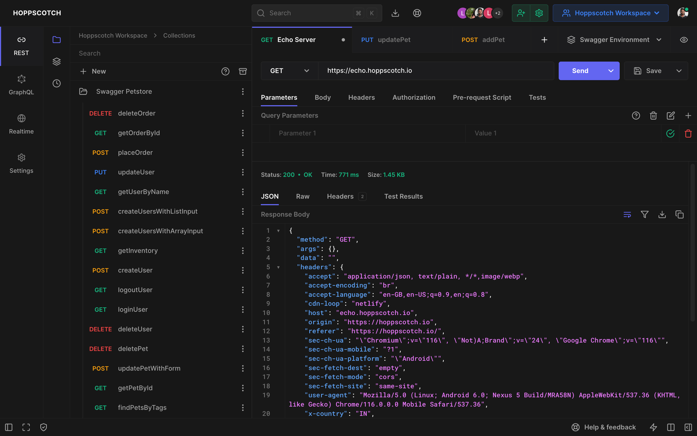

  
  <h3>
    <b>
      Hoppscotch
    </b>
  </h3>
  <b>
    开源 API 开发生态系统
  </b>
  

   

  

  

    
      由
      <a href="https://github.com/hoppscotch/hoppscotch/graphs/contributors">
        贡献者
      </a>
      用 ❤︎ 打造
    
  

   
  

    <a href="https://hoppscotch.io">
      <picture>
        <source media="(prefers-color-scheme: dark)" srcset="./packages/hoppscotch-common/public/images/banner-dark.png">
        <source media="(prefers-color-scheme: light)" srcset="./packages/hoppscotch-common/public/images/banner-light.png">
        
      </picture>
    </a>
  

> **语言**：本文档为简体中文翻译，[点此查看英文原版 README.md](README.md)。

_我们强烈推荐你查阅 [**Hoppscotch 文档**](https://docs.hoppscotch.io)，以了解更多关于本应用的信息。_

#### **支持**

  

### **功能特性**

❤️ **轻量：** 以极简的界面设计精心打造。

⚡️ **快速：** 实时发送请求并获取响应。

🗄️ **HTTP 方法：** 请求方法用于定义你所请求执行的动作类型。

- `GET` - 请求用于获取资源信息
- `POST` - 服务器在数据库中创建一条新记录
- `PUT` - 更新一个已存在的资源
- `PATCH` - 与 `PUT` 非常相似，但对资源做部分更新
- `DELETE` - 删除资源或相关组件
- `HEAD` - 获取与 GET 请求完全相同的响应头，但不包含响应体。
- `CONNECT` - 向由目标资源标识的服务器建立一条隧道
- `OPTIONS` - 描述目标资源的通信选项
- `TRACE` - 沿通往目标资源的路径执行一次消息回环测试
- `<custom>` - 一些 API 会使用自定义请求方法，例如 `LIST`。输入你自己的自定义方法。

🌈 **主题：** 背景、前景与强调色可自由组合自定义 — [立即自定义](https://hoppscotch.io/settings)。

- 选择主题：跟随系统偏好、浅色、深色与黑色
- 选择强调色：绿色、青色、蓝色、靛蓝、紫色、黄色、橙色、红色与粉色
- 无干扰的禅模式（Zen mode）

_自定义主题会与你的云端/本地会话同步。_

🔥 **PWA：** 作为[渐进式 Web 应用](https://web.dev/progressive-web-apps)安装到你的设备上。

- 借助 Service Workers 实现即时加载
- 离线支持
- 较低的 RAM/内存与 CPU 占用
- 添加到主屏幕
- 桌面端 PWA

🚀 **请求：** 即时从端点获取响应。

1. 选择 `method`
2. 输入 `URL`
3. 发送

- 复制/分享公开的 "Share URL"（分享链接）
- 为 10+ 种语言和框架生成/复制请求代码片段
- 导入 `cURL`
- 为请求打标签

🔌 **WebSocket：** 在单条 TCP 连接上建立全双工通信通道。

📡 **服务器发送事件（Server-Sent Events）：** 通过 HTTP 连接接收来自服务器的更新流，而无需诉诸轮询。

🌩 **Socket.IO：** 与 Socket.IO 服务器收发数据。

🦟 **MQTT：** 订阅并发布到 MQTT Broker 的主题。

🔮 **GraphQL：** GraphQL 是一种用于 API 的查询语言，也是一种运行时，用你已有的数据来完成这些查询。

- 设置端点并获取 schema
- 多列文档
- 设置自定义请求头
- 查询 schema
- 获取查询响应

🔐 **授权（Authorization）：** 用于识别终端用户。

- 无
- Basic
- Bearer Token
- OAuth 2.0
- OIDC Access Token/PKCE

📢 **请求头（Headers）：** 描述你请求体的发送格式。

📫 **参数（Parameters）：** 使用请求参数来设置模拟请求中的可变部分。

📃 **请求体（Request Body）：** 用于通过 REST API 发送和接收数据。

- 设置 `Content Type`
- FormData、JSON 以及更多
- 在键值对与 RAW 输入参数列表之间切换

📮 **响应（Response）：** 包含状态行、响应头以及消息/响应体。

- 将响应复制到剪贴板
- 将响应下载为文件
- 查看响应头
- 查看原始与预览的 HTML、图片、JSON 和 XML 响应

⏰ **历史记录：** 请求条目会与你的云端/本地会话存储同步。

📁 **集合（Collections）：** 通过集合和文件夹来组织你的 API 请求。一键即可复用。

- 无限量的集合、文件夹与请求
- 嵌套文件夹
- 以文件或 GitHub gist 的形式导出与导入

_集合会与你的云端/本地会话存储同步。_

📜 **前置脚本（Pre-Request Scripts）：** 与请求相关联、在请求发送之前执行的代码片段。

- 设置环境变量
- 在请求头中包含时间戳
- 在 URL 参数中发送一个随机字母数字字符串
- 任意 JavaScript 函数

👨‍👩‍👧‍👦 **团队（Teams）：** 帮助你在团队间协作，更快地设计、开发和测试 API。

- 创建无限量的团队
- 创建无限量的共享集合
- 创建无限量的团队成员
- 基于角色的访问控制
- 云端同步
- 多设备

👥 **工作区（Workspaces）：** 将你的个人与团队集合环境组织成工作区。在工作区之间轻松切换以管理多个项目。

- 创建无限量的工作区
- 在个人与团队工作区之间切换

⌨️ **键盘快捷键：** 为效率而优化。

> **[阅读我们关于键盘快捷键的文档](https://docs.hoppscotch.io/documentation/features/shortcuts)**

🌐 **代理（Proxy）：** 在设置中启用代理模式，以访问被封锁的 API。

- 隐藏你的 IP 地址
- 修复 [`CORS`](https://developer.mozilla.org/en-US/docs/Web/HTTP/CORS)（跨域资源共享）问题
- 访问以非 HTTPS（`http://`）端点提供的 API
- 使用你自己的代理 URL

_官方代理服务器由 Hoppscotch 托管 - **[GitHub](https://github.com/hoppscotch/proxyscotch)** - **[隐私政策](https://docs.hoppscotch.io/support/privacy)**。_

🌎 **国际化（i18n）：** 用你的语言体验本应用。

帮助我们翻译 Hoppscotch。关于我们的[`CODE OF CONDUCT`](CODE_OF_CONDUCT.md)以及向我们提交 pull request 的流程，请阅读 [`TRANSLATIONS`](TRANSLATIONS.md)。

☁️ **认证 + 同步：** 登录并在你的所有设备之间实时同步数据。

**登录方式：**

- GitHub
- Google
- Microsoft
- 邮箱
- SSO（单点登录）[^EE]

**🔄 同步你的数据：** 通过接力（Handoff）在你的其他设备上继续任务。

- 工作区
- 历史记录
- 集合
- 环境
- 设置

✅ **后置测试（Post-Request Tests）：** 编写与请求关联、在请求响应之后执行的测试。

- 以整数形式检查状态码
- 过滤响应头
- 解析响应数据
- 设置环境变量
- 编写 JavaScript 代码

🌱 **环境（Environments）：** 环境变量让你能够在请求和脚本中存储并复用值。

- 无限量的环境与变量
- 通过前置脚本进行初始化
- 以 GitHub gist 形式导出 / 导入

  
<i>使用场景</i>

---

- 把一个值存储在变量中，你就能在请求区域里引用它
- 如果需要更新该值，你只需在一处修改
- 使用变量能提升你高效工作的能力，并将出错的可能性降到最低

---

🚚 **批量编辑（Bulk Edit）：** 批量编辑键值对。

- 各条目以换行分隔
- 键与值以 `:` 分隔
- 在你想要添加但保持禁用的任何行前加上 `#`

🎛️ **管理控制台（Admin dashboard）：** 管理你的团队并邀请成员。

- 数据洞察
- 管理用户
- 管理团队

📦 **附加组件（Add-ons）：** hoppscotch 的官方附加组件。

- **[Hoppscotch CLI](https://github.com/hoppscotch/hoppscotch/tree/main/packages/hoppscotch-cli)** - Hoppscotch 的命令行界面。
- **[Proxy](https://github.com/hoppscotch/proxyscotch)** - 为 Hoppscotch 创建的简单代理服务器。
- **[浏览器扩展](https://github.com/hoppscotch/hoppscotch-extension)** - 增强你 Hoppscotch 体验的浏览器扩展。

  [ **Firefox**](https://addons.mozilla.org/en-US/firefox/addon/hoppscotch) &nbsp;|&nbsp; [ **Chrome**](https://chrome.google.com/webstore/detail/hoppscotch-extension-for-c/amknoiejhlmhancpahfcfcfhllgkpbld)

  > **扩展可修复 `CORS` 问题。**

_附加组件在 **[Hoppscotch 组织](https://github.com/hoppscotch)** 下开发与维护。_

**有关完整的功能列表，请阅读我们的[文档](https://docs.hoppscotch.io)。**

## **演示**

- Web ：[hoppscotch.io](https://hoppscotch.io)
- Windows/Linux/macOS ：[桌面应用](https://docs.hoppscotch.io/documentation/clients/desktop#download-hoppscotch-desktop-app)

## 使用方法

1. 在 URL 栏中填写你的 API 端点
2. 点击 "Send"（发送）以模拟请求
3. 查看响应

## 开发

请跟随我们的[自托管文档](https://docs.hoppscotch.io/documentation/self-host/getting-started)来搭建开发环境。

## 贡献

请使用 [GitHub Flow](https://guides.github.com/introduction/flow) 进行贡献。创建一个分支、添加提交，并[打开一个 pull request](https://github.com/hoppscotch/hoppscotch/compare)。

关于我们的[`CODE OF CONDUCT`](CODE_OF_CONDUCT.md)以及向我们提交 pull request 的流程，请阅读[`CONTRIBUTING`](CONTRIBUTING.md)。

## 持续集成

我们使用 [GitHub Actions](https://github.com/features/actions) 进行持续集成。请查看我们的[构建工作流](https://github.com/hoppscotch/hoppscotch/actions)。

## 更新日志

详情请查看 [`CHANGELOG`](CHANGELOG.md) 文件。

## 作者

本项目的存在，归功于所有贡献者的共同努力 — [立即贡献](CONTRIBUTING.md)。

  

## 许可证

本项目依据 [MIT License](https://opensource.org/licenses/MIT) 授权 — 详情请查看 [`LICENSE`](LICENSE) 文件。

[^EE]: 企业版功能。[了解更多](https://docs.hoppscotch.io/documentation/self-host/getting-started)。
